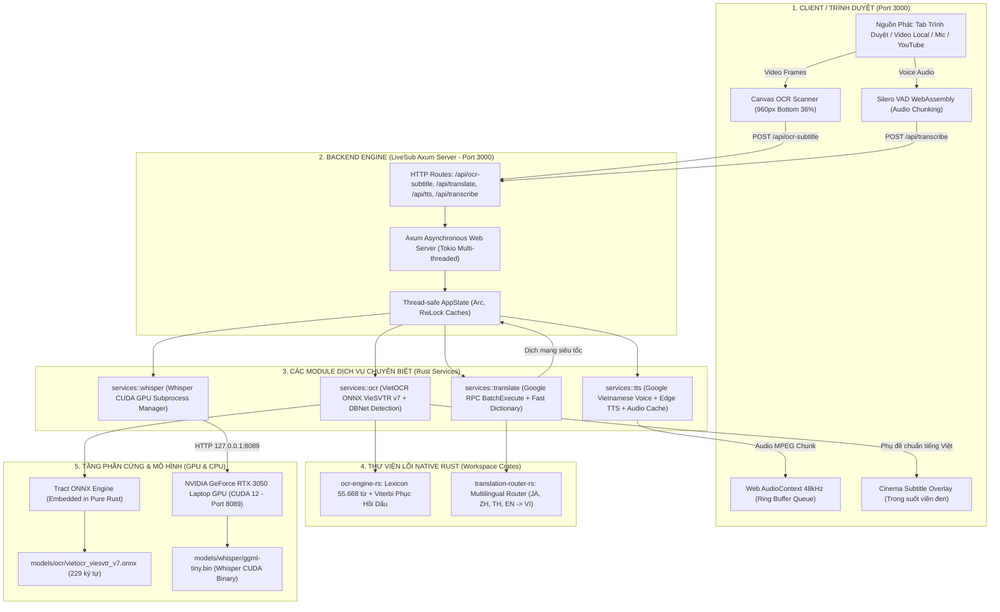

# 🏗️ Kiến Trúc Hệ Thống LiveSub & VoiceDub AI Studio (100% Native Rust)

Tài liệu chi tiết về kiến trúc phần mềm, cấu trúc module, luồng dữ liệu thời gian thực (*realtime streaming*), phân bổ tài nguyên phần cứng và ngân sách độ trễ (*latency budget*) của hệ thống LiveSub.

---

## 1. Sơ Đồ Kiến Trúc Tổng Thể

Hệ thống được tái cấu trúc theo mô hình **100% Native Rust Standalone Engine**, loại bỏ hoàn toàn Python runtime (`.py`), không dùng PyO3, không bị nghẽn GIL:



---

## 2. Phân Bổ Tài Nguyên Phần Cứng (Hardware Allocation)

Tối ưu hóa chuyên sâu cho cấu hình phổ biến **NVIDIA GeForce RTX 3050 (4GB VRAM) + CPU đa nhân**:

| Thành phần | Thiết bị phân bổ | Công nghệ / Engine | Mức tiêu thụ tài nguyên |
| :--- | :--- | :--- | :--- |
| **Whisper ASR (Nhận diện giọng nói)** | **GPU (CUDA 12)** | `whisper-server.exe` (cuBLAS / ggml-cuda) | ~600MB VRAM, xử lý trong ~150ms. |
| **VietOCR (Nhận diện chữ phụ đề)** | **CPU (Đa luồng)** | `pure-onnx-ocr` (Tract ONNX) | 0MB VRAM, suy luận trực tiếp ~270ms. |
| **Viterbi Lexicon (Khôi phục dấu)** | **CPU (Native Rust)** | `ocr-engine-rs` | < 1ms, từ điển 55.668 từ in-memory. |
| **Dịch Thuật (Translation Engine)** | **CPU / Network** | `translation-router-rs` + Google BatchExecute | ~50 - 150ms, cache 4096 câu. |
| **Lồng Tiếng (TTS Stream Engine)** | **CPU / Network** | Google Voice Engine (Pure Rust client) | ~75ms TTFA, cache 2048 file âm thanh. |

---

## 3. Cấu Trúc Thư Mục Sau Tái Cấu Trúc

```text
C:\dich\
├── bin\
│   └── livesub.exe                 # Bản phát hành 36MB độc lập (không lo mất khi xoá target)
├── models\
│   ├── ocr\
│   │   ├── ch_PP-OCRv4_det_infer.onnx   # Model phát hiện vùng chữ DBNet (4.7 MB)
│   │   ├── vietocr_viesvtr_v7.onnx      # Model nhận diện chữ VietOCR VieSVTR (30.6 MB)
│   │   └── vietocr_keys.txt             # Bảng mã 229 ký tự tiếng Việt đầy đủ thanh điệu
│   └── whisper\
│       ├── cuda\Release\                # Thư viện NVIDIA CUDA 12 (ggml-cuda.dll, cublasLt64)
│       └── ggml-tiny.bin                # Trọng số Whisper đa ngôn ngữ
├── public\                         # Giao diện Web LiveSub Studio (HTML5/CSS3/Vanilla JS)
│   ├── index.html
│   ├── app.js
│   └── style.css
├── rust\                           # Cargo Workspace 100% Pure Rust
│   ├── Cargo.toml                  # Workspace quản lý 3 crates chính (0 PyO3, 0 Python)
│   ├── ocr-engine-rs\              # Crate từ vựng, Viterbi phục hồi dấu tiếng Việt
│   ├── translation-router-rs\      # Crate định tuyến dịch thuật đa ngôn ngữ
│   └── livesub-app\                # Crate ứng dụng web server Axum
│       ├── Cargo.toml
│       └── src\
│           ├── main.rs             # Entrypoint khởi động gọn gàng (~64 dòng)
│           ├── config.rs           # Quản lý cấu hình ports, paths
│           ├── state.rs            # Thread-safe AppState & shared memory
│           ├── services\           # Tầng dịch vụ lõi (OCR, Whisper, Translate, TTS)
│           │   ├── mod.rs
│           │   ├── ocr.rs
│           │   ├── whisper.rs
│           │   ├── translate.rs
│           │   └── tts.rs
│           └── routes\             # Tầng HTTP Handlers phân tách rõ ràng
│               ├── mod.rs
│               ├── pipeline.rs
│               ├── ocr.rs
│               ├── translate.rs
│               ├── tts.rs
│               ├── transcribe.rs
│               └── youtube.rs
├── start.bat                       # Script khởi động 1-click tự phục hồi (Self-healing)
└── ARCHITECTURE.md                 # Tài liệu kiến trúc chuẩn xác
```

---

## 4. Ngân Sách Độ Trễ Toàn Tuyến (Realtime Latency Budget)

```
[0.0s] ─────────────────────────────────────────────────────────── [~0.55s]
  ├─ Chụp khung hình / Audio Chunk: ~50ms
  ├─ Nhận dạng VietOCR / Whisper GPU: ~150 - 270ms
  ├─ Khôi phục dấu Viterbi: < 1ms
  ├─ Dịch thuật song ngữ: ~50 - 100ms
  ├─ TTS phát khối đầu tiên (TTFA): ~75ms
  └─ Client WebAudio nhận và phát: ~10ms
  ══════════════════════════════════════════════════════════════════════
  Tổng cộng: ~450ms - 650ms (Đạt chuẩn truyền hình thuyết minh thời gian thực)
```

---

## 5. Cơ Chế Chịu Lỗi & Tự Phục Hồi (Self-Healing)

1. **Bảo vệ độc lập file chạy:** File `livesub.exe` được đặt tại `C:\dich\livesub.exe` và `C:\dich\bin\livesub.exe`. Dù người dùng có xoá sạch thư mục `rust/target` (để giải phóng dung lượng SSD), `livesub.exe` vẫn tồn tại nguyên vẹn.
2. **Khởi động tự kiểm tra:** Khi chạy `start.bat`, script tự động giải phóng cổng 3000 bị kẹt, tìm binary đã build và chỉ kích hoạt build lại nếu file chưa tồn tại.
3. **Tự động khôi phục Whisper CUDA:** Khi `livesub` khởi động, nếu server Whisper trên port 8089 chưa chạy, engine Rust sẽ tự động khởi tạo tiến trình con CUDA và tự kết nối lại.
